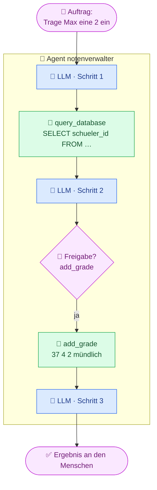

# Teil 2: Agenten & Multiagentensysteme

Im ersten Teil war **Claude Desktop** das Programm, das mit dem MCP-Server gesprochen hat.
In diesem Teil bauen wir dieses Programm – den **Harness** – selbst nach. So wird sichtbar, was sonst versteckt passiert:

- Was ist ein **Agent** – und was ist nur das **LLM**?
- Was macht der **Harness**?
- Wo greift der **Mensch** ein?
- Wie arbeiten **mehrere Agenten** zusammen?

## Lernpfad

| Kapitel | Inhalt |
|---|---|
| [1 · Begriffe](../docs/agenten/01_begriffe.md) | LLM, Tool, MCP, Agent, Harness, Workflow vs. Agent |
| [2 · Der Harness](../docs/agenten/02_harness.md) | Agenten-Schleife, Aufgaben des Harness, Rechte im Code |
| [3 · Mensch-Maschine-Schnittstellen](../docs/agenten/03_mensch_maschine.md) | S0–S5, Autonomiestufen, Verantwortung |
| [4 · Multiagentensysteme](../docs/agenten/04_multiagenten.md) | Koordinator & Spezialisten, Muster, Vor- und Nachteile, warum kein A2A |
| [5 · Aufgaben](../docs/agenten/05_aufgaben.md) | vom Rollenspiel bis zum eigenen Agenten-Team |
| [6 · Derselbe Agent in n8n](../docs/agenten/06_n8n.md) | n8n als zweiter Harness (Docker): Workflow vs. Agent, Freigabe per Formular |

## Schnellstart

Voraussetzung: Teil 1 ist eingerichtet (venv aktiv, `schule.db` erstellt). Es werden **keine weiteren Pakete** benötigt.

```powershell
# Welche Agenten gibt es?
python agenten/agent.py --liste

# 1) Du spielst selbst das LLM – kostenlos, ohne Internet
python agenten/llm_spielen.py                                        # bequem im Chat-Fenster
python agenten/agent.py --agent datenbank-analyst --modell mensch    # oder im Terminal

# 2) Mit Claude (API-Key von console.anthropic.com)
$env:ANTHROPIC_API_KEY = "sk-ant-..."
python agenten/agent.py --agent datenbank-analyst --modell anthropic "Welche Klasse hat den besten Mathe-Schnitt?"

# 3) Mit einem lokalen Modell über Ollama (https://ollama.com)
ollama pull qwen2.5:7b
python agenten/agent.py --agent datenbank-analyst --modell ollama "Welche Klasse hat den besten Mathe-Schnitt?"

# Human-in-the-Loop: Noten eintragen nur mit Freigabe
python agenten/agent.py --agent notenverwalter --modell anthropic

# Multiagentensystem
python agenten/agent.py --agent koordinator --modell anthropic "Kurze Zwischenstand-Rückmeldung für die Klasse 10a in Informatik vor der nächsten Schulaufgabe"
```

Weitere Optionen:

| Option | Wirkung |
|---|---|
| `--modellname NAME` | anderes Modell, z. B. `claude-sonnet-5-5` oder `llama3.1:8b` |
| `--url URL` | anderer OpenAI-kompatibler Server (LM Studio, OpenAI, Schulserver …) |
| `--alles-erlauben` | keine Freigaben mehr (Autonomiestufe 3 – zum Ausprobieren) |
| `--leise` | `[HARNESS]`-Zeilen ausblenden |
| `--weg-zeigen` | am Ende den Weg des Laufs als Diagramm im Browser öffnen |

## Selbst das LLM spielen (`--modell mensch`)

### Im Chat-Fenster (empfohlen)

```powershell
python agenten/llm_spielen.py
python agenten/llm_spielen.py --agent notenverwalter
python agenten/llm_spielen.py --agent koordinator "Zwischenstand Informatik 10a"
```

Es gibt zwei Arten von Fenstern:

| Fenster | Was du dort siehst bzw. tust |
|---|---|
| **Mensch & Harness** (Hauptfenster) | 👤 Auftrag eingeben, Rückfragen beantworten, Freigaben erteilen, Ergebnis lesen. Graue Zeilen zeigen, was der Harness gerade tut (lässt sich ausschalten). |
| **🤖 *agent* – du bist das LLM** (eines pro Agent) | Genau das, was der Harness diesem Agenten zeigt: links der Verlauf (📨 Auftrag, 🔧 Tool-Ergebnisse, rechts deine Antworten), rechts **Das sieht das LLM** mit System-Prompt und Tools (ein Klick auf ein Tool fügt eine Vorlage ein). Unten gibst du deine Antwort als LLM ein. Darunter steht schon beim Tippen, wie der Harness sie verstehen wird. |

**Mehrere Agenten:** Startest du z. B. als `koordinator` und delegierst an den `datenbank-analyst`, öffnet sich dessen Fenster und kommt nach vorn. Umschalten musst du nie, das macht der Harness. Gibt der Analyst seine Endantwort, kommt das Fenster des Koordinators wieder nach vorn, und die Antwort steht dort als Tool-Ergebnis. Die **Kette** oben im Fenster zeigt, wer wen beauftragt hat. Wird ein Agent ein zweites Mal beauftragt, wird sein Fenster geleert: neues Gedächtnis. So sieht man, dass der Harness für **jeden Agenten einen eigenen Kontext** baut.

Der **gelbe Rahmen** zeigt, wo gerade eine Eingabe erwartet wird. Bei einer Rückfrage kommt das Hauptfenster nach vorn. Freigaben (z. B. bei `add_grade`) erscheinen als Ja/Nein-Fenster.
Der Knopf **❓ Hilfe** erklärt ausführlich mit Beispielen, wie man als LLM handelt. Ein Klick auf ein Beispiel übernimmt es ins LLM-Feld.
Im Terminal läuft das gewohnte Protokoll mit. Es ist derselbe Harness wie bei `agent.py`, nur das Gehirn (`FensterLLM`) und der Mensch (`FensterMensch`) sind ausgetauscht.

### Im Terminal

Mit `--modell mensch` bist **du** das Sprachmodell. Der Harness zeigt dir in einem Kasten genau das, was ein echtes LLM bekommen würde: System-Prompt, verfügbare Tools und neue Nachrichten. Danach wartet er bei `LLM>` auf deine Antwort.

Du hast **zwei Möglichkeiten**, genau wie ein echtes LLM:

| Du tippst … | Bedeutung | Was der Harness macht |
|---|---|---|
| `tool NAME {json-argumente}` | **Tool-Aufruf:** "Harness, führe dieses Tool für mich aus." | ruft das Tool über MCP auf und zeigt dir das Ergebnis als neue Nachricht `[tool]` |
| normalen Text (ohne `tool` am Anfang) | **Endantwort:** "Ich bin fertig." | beendet den Agenten und gibt deinen Text als Ergebnis aus |

So ist ein Tool-Aufruf aufgebaut:

- zuerst das Wort `tool`,
- dann der Name des Tools, **ohne** Klammern,
- dann die Argumente als JSON. Hat das Tool keine Argumente (wie `list_tables`), lässt du sie weg.

### Beispiel: eine Notenübersicht

```powershell
python agenten/agent.py --agent datenbank-analyst --modell mensch "Notenübersicht: Durchschnitt pro Klasse und Fach"
```

Jede Zeile gibst du nach einem eigenen `LLM>` ein. Dazwischen führt der Harness das Tool aus und zeigt dir das Ergebnis.

```text
LLM> tool list_tables
LLM> tool describe_table {"table_name": "noten"}
LLM> tool describe_table {"table_name": "kurse"}
LLM> tool query_database {"query": "SELECT k.klasse, k.fach, ROUND(AVG(n.note),2) AS schnitt, COUNT(*) AS anzahl FROM noten n JOIN kurse k ON n.kurs_id = k.id GROUP BY k.klasse, k.fach ORDER BY k.klasse, k.fach"}
LLM> Notenübersicht: 10a Informatik Schnitt 2,05 (12 Noten), 10b Informatik 3,41 (8 Noten), ...  SQL: SELECT k.klasse, ...
```

Die letzte Zeile beginnt **nicht** mit `tool`. Sie ist deine Endantwort, und damit ist der Lauf beendet.

### Typische Stolpersteine

| Eingabe | Problem |
|---|---|
| `list_tables()` oder `{list_tables()}` | Ohne `tool` am Anfang ist das **Text**. Der Harness hält es für deine Endantwort und beendet den Agenten. |
| `tool list_tables()` | Keine Klammern hinter den Namen. Richtig: `tool list_tables` |
| `tool describe_table {'table_name': 'noten'}` | JSON braucht **doppelte** Anführungszeichen: `{"table_name": "noten"}` |
| `tool describe_table noten` | Argumente immer als JSON mit Namen. Die Namen stehen in der Tool-Liste in Klammern, z. B. `describe_table(table_name)`. |

Bei ungültigem JSON bricht der Lauf nicht ab: Der Harness zeigt ein Beispiel und du versuchst es noch einmal.

> 💡 **Darum geht es:** Der Harness *rät* nicht, was du gemeint hast. Er schaut nur auf die **Form** deiner Antwort: Beginnt sie mit `tool`, führt er etwas aus, sonst ist der Lauf zu Ende. Ein echtes LLM muss genau diese Unterscheidung treffen. Bei Claude oder Ollama heißt der Tool-Aufruf intern `tool_calls` (siehe [harness/llm.py](harness/llm.py)).

## So liest du die Ausgabe

```
[MENSCH ] Auftrag: Wie viele Schüler hat die 7a?
[AGENT  ] ▶ Agent 'datenbank-analyst' startet (Gehirn: anthropic/claude-haiku-5-5)
[HARNESS] Schritt 1/10: sende 1 Nachricht(en) + 3 Tool(s) an das LLM …
[LLM    ] möchte Tool 'query_database' mit {"query": "SELECT COUNT(*) FROM schueler WHERE klasse='7a'"}
[MCP    ] tools/call → query_database
[MCP    ] Ergebnis: [{"COUNT(*)": 17}]
[HARNESS] Schritt 2/10: sende 3 Nachricht(en) + 3 Tool(s) an das LLM …
[LLM    ] Die Klasse 7a hat 5 Schüler.
[AGENT  ] ■ Agent 'datenbank-analyst' ist fertig (2 Schritt(e)).
```

Jede Zeile sagt dir, **wer** gerade handelt. Unteragenten erscheinen eingerückt mit `│`.
Das vollständige Protokoll (inkl. System-Prompts und ungekürzter Ergebnisse) liegt in `agenten/protokolle/`.

## Den Weg als Bild ansehen

Nach jedem Lauf speichert der Harness zusätzlich den **Weg durch die Agenten-Schleife** als Diagramm:

- `agenten/protokolle/lauf_…_weg.html`: im Browser öffnen (oder gleich mit `--weg-zeigen` starten)
- `agenten/protokolle/lauf_…_weg.md`: dasselbe Diagramm als [Mermaid](https://mermaid.js.org)-Text, z. B. für GitHub oder [mermaid.live](https://mermaid.live)



Die Farben entsprechen den Etiketten in der Konsole. Jeder Agent bekommt einen eigenen Kasten, Delegationen erscheinen als Pfeile *delegiert* und *Ergebnis*.
Rote Kästen zeigen, wo der Harness eingegriffen hat (blockiertes Tool, Schrittlimit).
Die HTML-Datei lädt nur das Zeichenprogramm mermaid.js aus dem Internet. Das Bild entsteht im Browser, die Daten des Laufs verlassen den Rechner nicht.

## Dateien

```
agenten/
├── agent.py               # Startprogramm (Kommandozeile)
├── llm_spielen.py         # du spielst das LLM – in Chat-Fenstern, eines pro Agent (tkinter)
├── minimal_agent.py       # der kleinste mögliche Agent – zum Vergleichen
├── definitionen/          # S0: Hier wird festgelegt, was jeder Agent ist und darf
│   ├── datenbank-analyst.md
│   ├── notenverwalter.md
│   ├── pruefer.md
│   ├── berichtsautor.md
│   └── koordinator.md
└── harness/               # Der Harness – jede Datei hat genau eine Aufgabe
    ├── harness.py         # die Agenten-Schleife, Rechteprüfung, Delegation
    ├── llm.py             # Verbindung zum LLM (Anthropic, Ollama, Mensch)
    ├── mcp_bruecke.py     # MCP-Client: tools/list und tools/call
    ├── mensch.py          # alle Mensch-Maschine-Schnittstellen an einem Ort
    ├── definition.py      # liest die Definitionsdateien
    ├── protokoll.py       # farbige Ausgabe + JSONL-Protokoll
    └── weg.py             # Weg des Laufs als Mermaid-Diagramm
```

## Hinweise für Lehrkräfte

- **Ohne Budget:** Der Modus `--modell mensch` deckt alle Kernideen ab (Kontext, Schleife, Tools, Rechte, Freigabe, Delegation). Er eignet sich besonders als Einstieg, weil die Schülerinnen und Schüler das LLM *selbst spielen*.
- **Lokale Modelle:** Ollama mit `qwen2.5:7b` oder `llama3.1:8b` beherrscht Tool-Aufrufe und läuft auf Rechnern mit ca. 8 GB freiem Arbeitsspeicher. Einzelagenten funktionieren gut; das Multiagenten-Team ist für kleine Modelle oft zu anspruchsvoll – auch das ist ein guter Diskussionsanlass.
- **Kosten mit der API:** Ein Lauf des Einzelagenten kostet mit `claude-haiku-5-5` Bruchteile eines Cents bis wenige Cent; das Team ein Mehrfaches (siehe Token-Tabelle am Ende jedes Laufs). Ein Ausgabenlimit in der Anthropic-Konsole ist empfehlenswert.
- **Datenschutz:** Die Datenbank enthält ausschließlich erfundene Daten. Bei `--modell anthropic` werden Abfrageergebnisse an den Anbieter übertragen – mit echten Schülerdaten wäre das nicht zulässig. Guter Gesprächsanlass!
- **Kein A2A – mit Absicht:** Das Protokoll A2A (*Agent2Agent*) verbindet Agenten, die verschiedenen Besitzern gehören und als eigene Server laufen. Hier gehören alle Agenten demselben Besitzer und laufen in **einem** Harness. Delegation ist deshalb ein einfacher Funktionsaufruf, und der ganze Ablauf bleibt im Protokoll sichtbar. Ausführlich in [Kapitel 4](../docs/agenten/04_multiagenten.md#und-a2a-warum-wir-es-hier-nicht-verwenden).
- **Datenbank zurücksetzen:** `add_grade` verändert `schule.db`. Mit `python create_database.py` wird sie auf den Ausgangsstand zurückgesetzt.
