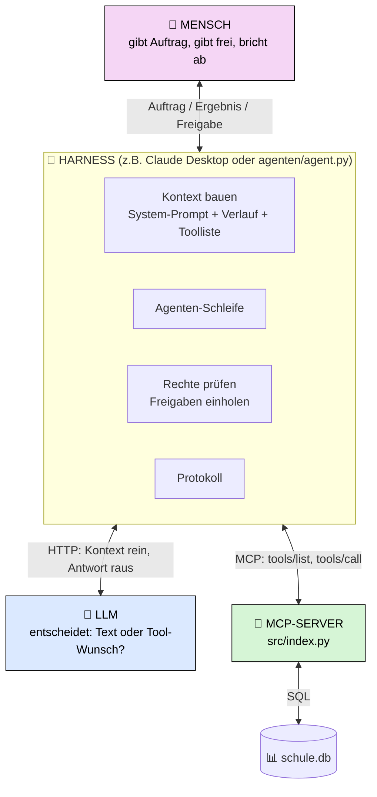

# 1 · Die Begriffe: LLM, Tool, MCP, Agent, Harness

> **Leitfrage:** Wer macht eigentlich *was*, wenn „die KI“ eine Datenbank abfragt?

Im ersten Teil des Projekts hast du Claude Desktop eine Frage gestellt und Claude hat die Datenbank abgefragt. Das wirkt wie *ein* Programm. Tatsächlich arbeiten dabei mehrere klar trennbare Teile zusammen. Wer sie auseinanderhalten kann, versteht jedes KI-Agenten-System.

---

## Die Bausteine

| Begriff | Definition (zum Merken) | In diesem Projekt |
|---|---|---|
| **LLM** (Large Language Model) | Ein Programm, das zu einem Text die wahrscheinlichste Fortsetzung erzeugt. Es **kann nichts ausführen** und **merkt sich nichts** zwischen zwei Aufrufen. | Claude, Qwen über Ollama – oder **du selbst** im Modus `mensch` |
| **Tool** (Werkzeug) | Eine normale Funktion in einem Programm. Das LLM bekommt nur ihren **Namen**, eine **Beschreibung** und die **Parameter** zu sehen. | `query_database`, `list_tables`, `describe_table`, `add_grade` |
| **MCP** (Model Context Protocol) | Ein offener Standard, *wie* ein Programm Tools anbietet (Server) und wie man sie abfragt und aufruft (Client). | `src/index.py` ist der **MCP-Server** |
| **Harness** | Das Rahmenprogramm um das LLM herum. Es baut den Kontext, ruft das LLM auf, prüft und führt Tool-Wünsche aus, setzt Grenzen und ist die Schnittstelle zum Menschen. | Claude Desktop – oder unser eigener Harness in `agenten/harness/` |
| **Agent** | Ein System, in dem ein LLM **in einer Schleife selbst entscheidet**, welche Tools es nutzt, um ein **Ziel** zu erreichen. | z. B. `datenbank-analyst`, `notenverwalter` |
| **Multiagentensystem** | Mehrere Agenten mit eigenen Rollen, eigenem Kontext und eigenen Rechten, die gemeinsam eine Aufgabe lösen. | `koordinator` + Spezialisten |

### Die wichtigste Formel

```
Agent  =  LLM  +  Tools  +  Schleife  +  Ziel        (und Grenzen, die der Harness setzt)
```

Fehlt die Schleife, ist es ein **Chatbot**. Fehlen die Tools, kann der Agent nur reden, aber nichts *tun*. Fehlt das Ziel, weiß er nicht, wann er fertig ist.

---

## Das Bild zum Merken: Pferd, Geschirr, Kutscher

Das englische Wort *harness* bedeutet **Geschirr** – das Zaumzeug eines Zugpferds.

| | Pferdekutsche | KI-Agent |
|---|---|---|
| Kraft | Das **Pferd** ist stark, weiß aber nicht, wohin die Fahrt geht. | Das **LLM** ist sprachlich stark, kann aber selbst nichts ausführen. |
| Lenkung | Das **Geschirr** überträgt die Kraft auf den Wagen und begrenzt, wohin das Pferd kann. | Der **Harness** verbindet das LLM mit Tools und begrenzt, was es darf. |
| Verantwortung | Der **Kutscher** gibt das Ziel vor, hält die Zügel und kann bremsen. | Der **Mensch** gibt den Auftrag, gibt Aktionen frei und kann abbrechen. |
| Wagen | Die Ladung, die bewegt werden soll | Die **Tools** und Daten (MCP-Server, Datenbank) |

Ein starkes Pferd ohne Geschirr ist nutzlos – oder gefährlich. Genauso ist es mit einem LLM ohne Harness.

---

## Schichtenmodell



**Merke:** Das LLM hat **keine direkte Verbindung** zur Datenbank. Jeder Zugriff läuft über den Harness. Deshalb kann der Harness auch alles kontrollieren.

---

## Workflow oder Agent?

Nicht jedes System mit LLM ist ein Agent. Man unterscheidet:

| | **Workflow** | **Agent** |
|---|---|---|
| Wer bestimmt den Ablauf? | Der **Programmierer** legt die Schritte fest. | Das **LLM** entscheidet zur Laufzeit. |
| Beispiel | „Übersetze jede neue E-Mail und speichere sie ab.“ – immer dieselben Schritte | „Finde heraus, welche Klasse in Mathe am schwächsten ist.“ – welche Abfragen nötig sind, entscheidet das Modell |
| Vorteil | vorhersagbar, günstig, leicht zu testen | flexibel bei offenen Aufgaben |
| Nachteil | unflexibel | weniger vorhersagbar, teurer, braucht Grenzen |

Faustregel: **So einfach wie möglich.** Einen Agenten baut man erst, wenn ein fester Ablauf nicht reicht.
(Nach Anthropic: *[Building effective agents](https://www.anthropic.com/engineering/building-effective-agents)*)

> 🔎 **Direkt vergleichen:** In [Kapitel 6](06_n8n.md) stehen ein fester Workflow und ein Agent in n8n nebeneinander. Beide benutzen denselben MCP-Server.

---

## Was „sieht“ ein LLM eigentlich?

Bei **jedem** Aufruf schickt der Harness dem LLM ein Paket aus drei Teilen. Das LLM sieht nichts anderes:

1. **System-Prompt** – Rolle, Regeln, Ziel (steht in `agenten/definitionen/*.md`)
2. **Verlauf** – alle bisherigen Nachrichten: Auftrag, eigene Tool-Wünsche, Tool-Ergebnisse
3. **Toolliste** – Name, Beschreibung und Parameter jedes erlaubten Tools

Weil das LLM sich nichts merkt, muss der Harness den **kompletten Verlauf jedes Mal neu mitschicken**. Deshalb steht im Protokoll bei jedem Schritt z. B. `sende 5 Nachricht(en) + 3 Tool(s) an das LLM`.

> 🔬 **Selbst erleben:** Starte `python agenten/agent.py --modell mensch`. Du siehst dann genau dieses Paket und musst selbst als LLM antworten.

---

## Kontrollfragen

1. Erkläre, warum ein LLM allein **kein** Agent ist.
2. Ordne zu: Claude Desktop, `src/index.py`, Claude Sonnet, `schule.db` – welcher Baustein ist was?
3. Ein LLM „ruft ein Tool auf“. Was passiert dabei *wirklich*? Wer führt den Code aus?
4. Nenne ein Beispiel aus dem Schulalltag, für das ein Workflow besser ist als ein Agent.
