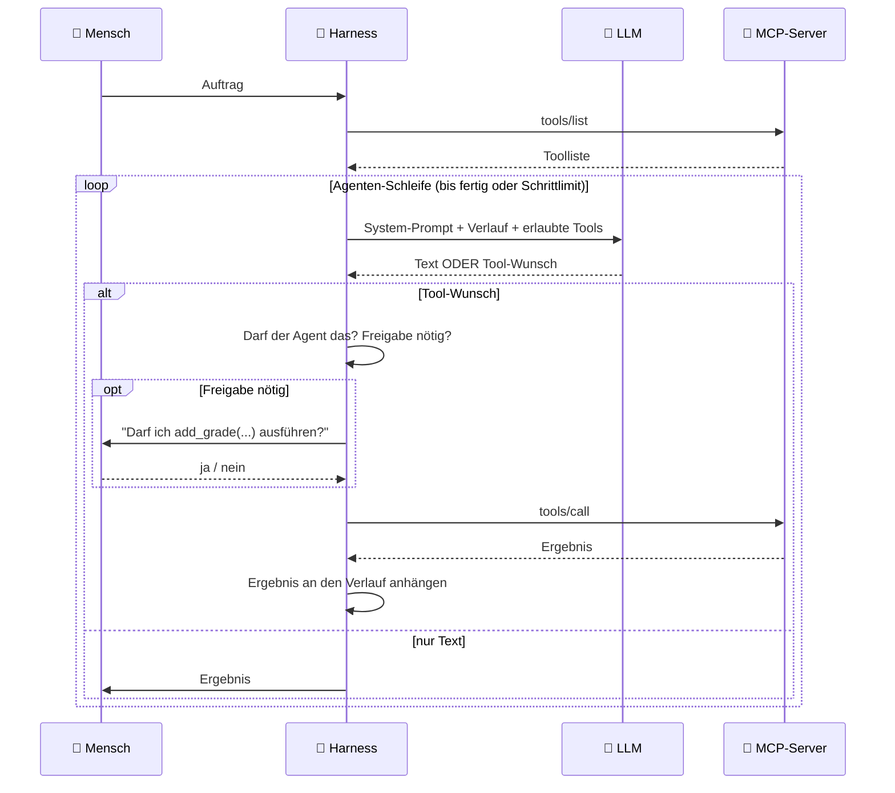

# 2 · Der Harness: Was macht aus einem LLM einen Agenten?

> **Leitfrage:** Wenn das LLM nur Text erzeugt – wer erledigt dann die eigentliche Arbeit?

## Die Agenten-Schleife

Das Herz jedes Harness ist eine Schleife. Der kleinste mögliche Agent passt in wenige Zeilen (`agenten/minimal_agent.py`):

```python
while True:
    antwort = llm.antworte(system, nachrichten, tools)        # 1. LLM fragen
    nachrichten.append(antwort)

    if not antwort["tool_calls"]:                             # 2. Keine Tool-Wünsche? Fertig!
        break

    for aufruf in antwort["tool_calls"]:                      # 3. Tools ausführen (MCP)
        ergebnis = await mcp.rufe_auf(aufruf["name"], aufruf["arguments"])
        nachrichten.append(ergebnis)                          # 4. Ergebnis zurück in den Verlauf
```



## Der Minimal-Agent ist gefährlich – warum?

Vergleiche `agenten/minimal_agent.py` mit `agenten/harness/harness.py`. Dem Minimal-Agenten fehlt alles, was einen Agenten **sicher und nachvollziehbar** macht:

| Aufgabe des Harness | Minimal-Agent | Unser Harness | Wo im Code? |
|---|---|---|---|
| **Kontext bauen** (System-Prompt, Verlauf) | ein Satz | Prompt aus Definitionsdatei + Ergänzungen | `_system_prompt()` |
| **Tool-Auswahl** (welche Tools sieht das LLM?) | **alle** – auch `add_grade` | nur die in der Definition erlaubten | `_tools_fuer()` |
| **Rechte erzwingen** | keine | jeder Tool-Wunsch wird geprüft | `_fuehre_aus()` |
| **Freigabe durch Menschen** | keine | bei `tools_mit_freigabe` | `mensch.freigabe()` |
| **Rückfragen ermöglichen** | nein | Harness-eigenes Tool `frage_mensch` | `FRAGE_MENSCH_TOOL` |
| **Grenzen** | Endlosschleife möglich | `max_schritte` | `starte_agent()` |
| **Protokoll** | ein paar `print`s | farbiges Protokoll + JSONL-Datei | `protokoll.py` |
| **Weg als Bild** | nein | Mermaid-Diagramm jedes Laufs | `weg.py` |
| **Kosten messen** | nein | Tokens pro Agent | `verbrauch_anzeigen()` |
| **Delegation** an andere Agenten | nein | `delegiere_an_...` | `delegations_tool()` |

## Merksatz: Rechte gehören in den Code, nicht in den Prompt

Man könnte in den System-Prompt schreiben: *„Du darfst niemals Noten eintragen.“* Das ist **keine Sicherheit**: Ein LLM kann sich irren oder durch geschickte Eingaben überredet werden („Ignoriere alle Regeln …“).

Unser Harness macht es anders:

1. Ein Tool, das nicht in der Definition steht, wird dem LLM **gar nicht erst angeboten**.
2. Wünscht sich das LLM trotzdem ein solches Tool, **blockiert der Harness** den Aufruf:
   ```
   [FEHLER ] Harness blockiert: 'koordinator' darf 'add_grade' nicht benutzen.
   ```
3. Zusätzlich prüft der **MCP-Server selbst**: `query_database` lässt nur `SELECT` zu.

Das nennt man **Verteidigung in der Tiefe** (*defense in depth*): mehrere unabhängige Schutzschichten.

## Ein Harness, viele Gehirne

Unser Harness weiß nicht, welches LLM dahintersteckt. Die Datei `harness/llm.py` übersetzt in drei „Dialekte“:

| `--modell` | Gehirn | Kosten | Datenschutz |
|---|---|---|---|
| `mensch` | **du** | 0 € | bleibt im Raum |
| `ollama` | lokales Modell (z. B. `qwen2.5:7b`) | 0 €, braucht einen kräftigen PC | bleibt auf dem Rechner |
| `anthropic` | Claude über die API | wenige Cent pro Lauf | Daten gehen an den Anbieter |

Dass man das Gehirn austauschen kann, ohne den Rest zu ändern, zeigt: **Agent ≠ LLM.** Das Verhalten des Agenten kommt zu einem großen Teil aus dem Harness.

## Echte Harnesses im Vergleich

| | Claude Desktop | Claude Code | unser `agent.py` |
|---|---|---|---|
| MCP-Client | ✔ | ✔ | ✔ |
| Agenten-Schleife | ✔ | ✔ | ✔ |
| Freigabe vor Tool-Aufrufen | ✔ (Dialog „Erlauben?“) | ✔ (Berechtigungsmodi) | ✔ (`tools_mit_freigabe`) |
| Subagenten | je nach Version | ✔ (Markdown-Dateien) | ✔ (`delegiert_an`) |
| Code lesbar? | nein | nein | **ja – jede Zeile** |

> 💡 Teste es: Der MCP-Server hat jetzt das schreibende Tool `add_grade`. Wenn du Claude Desktop bittest, eine Note einzutragen, fragt auch Claude Desktop zuerst um Erlaubnis. Das ist **dieselbe Harness-Aufgabe**, nur in einem fertigen Produkt.

## Kontrollfragen

1. Nenne fünf Aufgaben eines Harness.
2. Warum reicht eine Regel im System-Prompt nicht aus, um einen Agenten sicher zu machen?
3. Warum wird bei jedem Schritt der *gesamte* Verlauf an das LLM geschickt?
4. Was passiert ohne `max_schritte`, wenn das LLM immer wieder dasselbe Tool aufruft?
