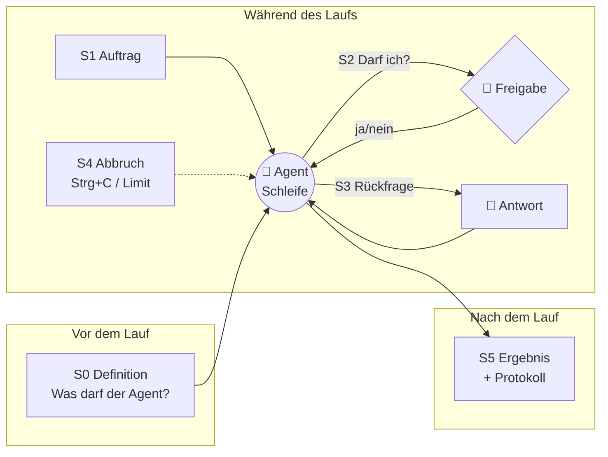

# 3 · Mensch-Maschine-Schnittstellen

> **Leitfrage:** An welchen Stellen hat der Mensch die Kontrolle – und wo gibt er sie ab?

Ein Agent handelt selbstständig. Trotzdem bleibt ein Mensch **verantwortlich**. Damit das funktioniert, braucht es klar definierte Schnittstellen. In unserem Projekt stehen sie alle gesammelt in **einer** Datei: `agenten/harness/mensch.py`.

## Die sechs Schnittstellen

| Nr. | Schnittstelle | Richtung | Wann? | In unserem Code |
|---|---|---|---|---|
| **S0** | **Definition** | Mensch → Agent | *vor* dem Lauf | Definitionsdatei: Rolle, Tools, Rechte, Schrittlimit |
| **S1** | **Auftrag** | Mensch → Agent | Start | `mensch.auftrag_holen()` |
| **S2** | **Freigabe** | Agent → Mensch → Agent | vor riskanten Aktionen | `mensch.freigabe()` bei `tools_mit_freigabe` |
| **S3** | **Rückfrage** | Agent → Mensch → Agent | bei Unklarheit | Tool `frage_mensch` |
| **S4** | **Abbruch** | Mensch/Harness → Agent | jederzeit | Strg+C, `max_schritte` |
| **S5** | **Ergebnis & Protokoll** | Agent → Mensch | Ende (und danach) | `mensch.ergebnis_zeigen()`, `protokolle/*.jsonl` |



### Jede Schnittstelle im Protokoll erkennen

| Etikett | Bedeutung |
|---|---|
| `[MENSCH ]` | Hier hat ein Mensch etwas eingegeben oder entschieden. |
| `[AGENT  ] ❓` | Der Agent stellt eine Rückfrage (S3). |
| `[HARNESS] ⚠ FREIGABE NÖTIG` | Der Harness hält an und wartet auf den Menschen (S2). |
| `[FEHLER ] Harness blockiert` | S0 wirkt: Der Agent wollte etwas, das er nicht darf. |

## Autonomiestufen

Wie viel Kontrolle der Mensch abgibt, ist eine **bewusste Entscheidung**. Man kann sie in Stufen beschreiben:

| Stufe | Name | Wer handelt? | Rolle des Menschen | Beispiel im Projekt |
|---|---|---|---|---|
| 0 | **Chatbot** | niemand | liest Antworten | LLM ohne Tools |
| 1 | **Assistent** | Mensch | führt Vorschläge selbst aus | LLM schlägt SQL vor, du tippst sie ab |
| 2 | **Human-in-the-Loop** | Agent | gibt jede riskante Aktion frei | `notenverwalter` |
| 3 | **Human-on-the-Loop** | Agent | beobachtet, kann abbrechen | `notenverwalter --alles-erlauben` |
| 4 | **Human-out-of-the-Loop** | Agent | nicht beteiligt | (in diesem Projekt bewusst nicht vorgesehen) |

Je höher die Stufe, desto **bequemer** – aber desto **größer das Risiko** und desto wichtiger sind S0 (gute Grenzen) und S5 (gutes Protokoll).

### Lesen frei, Schreiben nur mit Freigabe

Unsere Agenten folgen einem einfachen Prinzip, das auch in echten Systemen gilt:

- **Lesende** Aktionen (`query_database`, `list_tables`) sind ungefährlich → keine Freigabe
- **Schreibende** Aktionen (`add_grade`) verändern die Welt → Freigabe durch den Menschen
- **Löschende** oder **unumkehrbare** Aktionen → gibt es gar nicht als Tool

Dazu kommt das **Prinzip der minimalen Rechte** (*least privilege*): Jeder Agent bekommt nur die Tools, die er für seine Aufgabe wirklich braucht. Der `berichtsautor` hat zum Beispiel **gar keinen** Datenbankzugriff.

## Gute Freigaben gestalten

Eine Freigabe-Frage ist nur dann sinnvoll, wenn der Mensch sie **verstehen** und **prüfen** kann:

```
⚠ FREIGABE NÖTIG: Agent 'notenverwalter' möchte 'add_grade' aufrufen mit
  {"schueler_id": 9, "kurs_id": 6, "note": 2.0, "art": "mündlich"}
```

Diskussionsfrage: Weißt du hier, *welcher* Schüler und *welches* Fach gemeint ist? Wie müsste die Freigabe aussehen, damit du sie verantwortungsvoll erteilen kannst?

> ⚠️ **Gefahr der Gewöhnung:** Wer 50-mal hintereinander „ja“ drückt, liest irgendwann nicht mehr hin. Zu viele Freigaben sind fast so schlecht wie keine.

> 🖼️ **Zum Vergleich:** Die Freigabe-App aus [Teil 1b](../mcp-apps.md) zeigt Namen statt ids und lässt den Menschen bei mehreren Treffern selbst auswählen.

## Wer baut die Oberfläche? MCP Apps und A2UI

Die meisten Schnittstellen in diesem Kapitel sind Text: Auftrag eintippen, „j“ drücken, Protokoll lesen. Agenten können dem Menschen aber auch **Oberflächen** zeigen: Tabellen, Formulare, Knöpfe. Dafür gibt es zwei verschiedene Ansätze:

| | **MCP Apps** ([Teil 1b](../mcp-apps.md)) | **A2UI** (Agent-to-User Interface, von Google) |
|---|---|---|
| Wer legt die Oberfläche fest? | ein **Programmierer**, vorher | das **LLM**, zur Laufzeit |
| Was wird übertragen? | eine fertige HTML-Seite | eine Beschreibung als JSON: „eine Karte mit Überschrift, darunter zwei Knöpfe …“ |
| Wer zeichnet die Oberfläche? | der Browser im abgeschotteten iframe | der Client, mit **eigenen, vertrauenswürdigen** Bausteinen aus einem festen Katalog |
| Wird fremder Code ausgeführt? | ja, das JavaScript der App (deshalb Sandbox und CSP) | nein, nur Daten |
| Vergleichbar mit | **Workflow**: fester Ablauf | **Agent**: entscheidet selbst |

Das ist dieselbe Unterscheidung wie in Kapitel 1 („Workflow oder Agent?“), diesmal für Oberflächen. Beide Ansätze lassen sich kombinieren: A2UI-Oberflächen können auch *innerhalb* einer MCP-App angezeigt werden.

**Was bedeutet das für die Kontrolle durch den Menschen?**

- Bei MCP Apps kann man die Freigabe-Seite vorher prüfen und testen. Sie sieht jedes Mal gleich aus.
- Bei A2UI denkt sich das LLM die Seite jedes Mal neu aus. Das ist flexibel, aber der Mensch muss der Oberfläche selbst vertrauen können. Was, wenn ein Knopf „Abbrechen“ heißt, aber etwas einträgt? Der feste Bausteinkatalog begrenzt, *was* das LLM bauen kann. *Was es darstellt* und *welche Aktion hinter einem Knopf liegt*, muss trotzdem der Harness prüfen.

> **Merke:** Eine Freigabe ist nur so gut wie die Anzeige, auf der sie beruht. Wer die Oberfläche baut, hat Einfluss darauf, was der Mensch freigibt.

## Verantwortung

Ein Agent kann nicht verantwortlich sein – er ist ein Programm. Verantwortlich sind:

- wer den Agenten **definiert** (S0): Welche Rechte wurden vergeben?
- wer den Harness **programmiert**: Werden die Rechte wirklich erzwungen?
- wer **freigibt** (S2): Wurde die Aktion geprüft?
- wer das Ergebnis **verwendet** (S5): Wurde es kontrolliert?

## Kontrollfragen

1. Ordne zu: Strg+C, `tools_mit_freigabe: add_grade`, `frage_mensch`, die JSONL-Datei – welche Schnittstelle ist das jeweils?
2. Warum hat der `notenverwalter` das Tool `frage_mensch`, der `datenbank-analyst` aber nicht?
3. Auf welche Autonomiestufe würdest du einen Agenten setzen, der Zeugnisnoten berechnet? Begründe.
4. Ein Agent trägt eine falsche Note ein, nachdem du „j“ gedrückt hast. Wer ist verantwortlich?
5. Ein LLM baut mit A2UI selbst eine Freigabe-Oberfläche. Welche neuen Risiken entstehen im Vergleich zur festen Freigabe-App aus Teil 1b?
