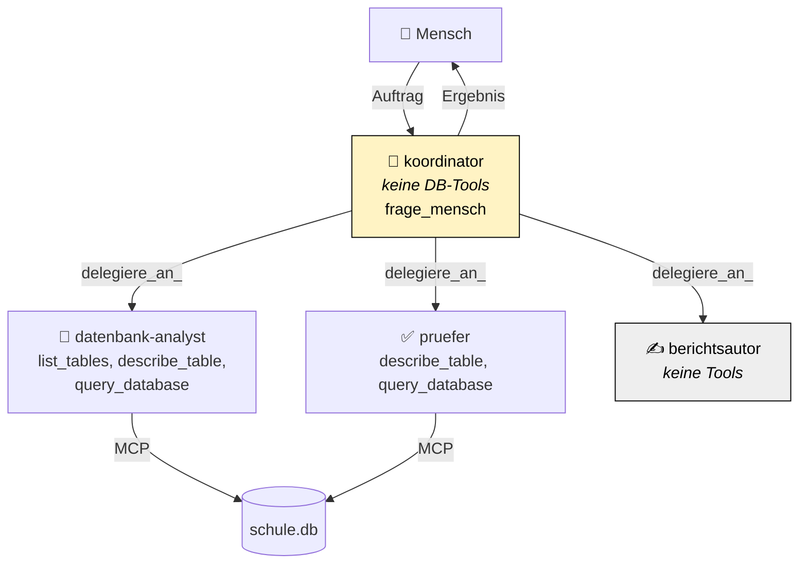

# 4 · Multiagentensysteme

> **Leitfrage:** Wann ist ein Team aus Agenten besser als ein einzelner Agent – und wann nicht?

## Was ist ein Multiagentensystem?

Ein **Multiagentensystem** besteht aus mehreren Agenten, die zusammen eine Aufgabe lösen. Jeder Agent hat

- eine eigene **Rolle** (eigener System-Prompt),
- einen eigenen **Kontext** (eigener Verlauf – er sieht nicht, was die anderen erlebt haben),
- eigene **Rechte** (eigene Tools).

Technisch ist das bei uns überraschend einfach: **Ein Agent wird für einen anderen Agenten zum Tool.** Der Koordinator sieht in seiner Toolliste zum Beispiel:

```
delegiere_an_datenbank-analyst(auftrag)
delegiere_an_pruefer(auftrag)
delegiere_an_berichtsautor(auftrag)
```

Ruft er so ein „Tool“ auf, startet der Harness einen **neuen Agenten mit leerem Verlauf**. Dessen Endergebnis kommt als Tool-Ergebnis zum Koordinator zurück.

## Unser Team



| Agent | Rolle | Darf in die DB? | Warum so? |
|---|---|---|---|
| `koordinator` | zerlegt den Auftrag, verteilt, fasst zusammen | **nein** | Er soll planen, nicht selbst rechnen. |
| `datenbank-analyst` | holt Fakten per SQL | lesen | Spezialist für SQL |
| `pruefer` | prüft Zahlen unabhängig nach | lesen | **Vier-Augen-Prinzip** |
| `berichtsautor` | schreibt Rückmeldung an die Klasse | **nein** | Kann keine Daten „nachschlagen“ und dabei Namen oder Einzelnoten preisgeben |

Starten:

```powershell
python agenten/agent.py --agent koordinator --modell anthropic "Schreibe eine kurze Zwischenstand-Rückmeldung für die Klasse 10a in Informatik, die ich vor der nächsten Schulaufgabe an alle verschicken kann."
```

Im Protokoll siehst du die Unteragenten **eingerückt** (`│`). So erkennst du, welcher Agent gerade arbeitet.

## Typische Muster

| Muster | Ablauf | Beispiel |
|---|---|---|
| **Koordinator–Spezialisten** (*orchestrator–workers*) | Ein Agent plant und verteilt Teilaufgaben, sammelt die Ergebnisse ein. | unser `koordinator` |
| **Pipeline** | Agent A → Agent B → Agent C, fest verdrahtet | Analyst → Prüfer → Autor in fester Reihenfolge (eigentlich ein *Workflow*) |
| **Erzeuger–Prüfer** (*evaluator–optimizer*) | Einer erstellt, ein anderer kritisiert, bis die Qualität stimmt | `datenbank-analyst` + `pruefer` |
| **Parallel** | Mehrere Agenten arbeiten gleichzeitig an Teilen, Ergebnisse werden zusammengeführt | Je ein Analyst pro Klasse |

## Warum mehrere Agenten?

| Vorteil | Erklärung |
|---|---|
| **Spezialisierung** | Kurze, klare System-Prompts statt eines Riesen-Prompts für alles |
| **Saubere Kontexte** | Jeder Unteragent startet frisch und wird nicht von langen Zwischenergebnissen abgelenkt |
| **Minimale Rechte** | Jeder bekommt nur die Tools, die er braucht |
| **Kontrolle** | Ein unabhängiger Prüfer findet Fehler, die der Ersteller übersieht |

## Warum lieber nicht?

| Nachteil | Erklärung |
|---|---|
| **Kosten** | Jeder Agent bekommt bei jedem Schritt seinen ganzen Kontext neu → viel mehr Tokens. Schau dir am Ende die Tabelle *„LLM-Aufrufe und Tokens pro Agent“* an! |
| **Stille Post** | Unteragenten kennen den Verlauf nicht. Vergisst der Koordinator eine Information im Auftrag (z. B. die Klasse), arbeitet der Unteragent mit falschen Annahmen. |
| **Fehlerfortpflanzung** | Ein Fehler des Analysten wandert ungeprüft in den Bericht – wenn niemand prüft. |
| **Schwerer nachzuvollziehen** | Mehr Agenten = längeres Protokoll |

> **Faustregel:** Erst einen einzelnen Agenten bauen. Ein Team nur dann, wenn Aufgaben sich klar trennen lassen **und** der Nutzen die Kosten rechtfertigt.

## Wie wird ein Team *definiert*?

Alles steht in den Definitionsdateien – kein Agent „weiß“ etwas, das dort nicht steht:

```markdown
---
name: koordinator
beschreibung: Zerlegt größere Aufträge in Teilaufgaben und verteilt sie an Spezialisten.
tools:
mensch_fragen: ja
delegiert_an: datenbank-analyst, pruefer, berichtsautor
max_schritte: 12
---
Du bist der Koordinator eines kleinen Agenten-Teams ...
```

Die Zeile `beschreibung` ist wichtig: Sie landet in der Tool-Beschreibung von `delegiere_an_...`. **Daran entscheidet der Koordinator, wen er beauftragt.**

## Und A2A? Warum wir es hier nicht verwenden

In der Praxis taucht bei Multiagentensystemen oft der Begriff **A2A** (*Agent2Agent*) auf. Das ist ein offenes Protokoll, über das Agenten miteinander sprechen. MCP verbindet einen Agenten mit seinen **Tools**, A2A verbindet **Agenten untereinander**.

In diesem Projekt gibt es **kein A2A**, und das ist Absicht.

### Wofür A2A gedacht ist

A2A löst ein bestimmtes Problem: Agenten, die **verschiedenen Besitzern** gehören, sollen zusammenarbeiten. Zum Beispiel läuft ein Agent bei der Schule, ein anderer bei einem Schulbuchverlag, mit anderem Programm, anderem LLM, auf einem anderen Server. Keiner darf in den anderen hineinschauen.

Deshalb ist bei A2A **jeder Agent ein eigener Server mit eigenem Harness**. Er veröffentlicht eine **Agent Card**, eine Visitenkarte im JSON-Format. Darin steht, **was** er kann (seine *Skills*), aber nicht, **womit** er es tut: keine Tools, kein System-Prompt, kein LLM. Andere Agenten schicken ihm Aufträge über das Netz und bekommen Antworten zurück. Mehr erfahren sie nicht.

### Warum wir es nicht brauchen

Bei uns gilt: **ein Harness, ein Besitzer, alle Agenten.**

- Alle Agenten gehören uns, liegen als Dateien in `agenten/definitionen/` und laufen **im selben Python-Programm**.
- **Ein einziger Harness** spielt alle Agenten nacheinander. Delegieren ist bei uns ein einfacher Funktionsaufruf (`starte_agent(...)` in `harness.py`), keine Nachricht über das Netz.
- Der Harness darf alle Definitionen kennen, denn es gibt niemanden, vor dem man sie verstecken müsste. Getrennt wird nur das, was die **LLMs** sehen: Jedes bekommt nur seine eigenen Tools.

A2A würde hier nur Aufwand bringen (mehrere Server, Ports, Netzwerkfehler, mehr Arbeitsspeicher), aber nichts Neues über Agenten zeigen. Außerdem würde jeder Agent zur Blackbox. Das Protokoll und das Weg-Diagramm, in denen man den ganzen Ablauf sieht, gingen verloren.

Übrigens arbeiten auch die meisten Multiagentensysteme in der Praxis **so wie unseres**: Claude Code mit Subagents, CrewAI, LangGraph oder n8n mit mehreren Agenten-Knoten. **Multiagentensystem heißt also nicht automatisch A2A.**

### Was bei uns die Rolle von A2A übernimmt

| Bei A2A | Bei uns |
|---|---|
| Agent Card mit Skills | die Zeile `beschreibung` in der Definitionsdatei |
| Auftrag als Nachricht über das Netz | Tool `delegiere_an_...` → Funktionsaufruf im Harness |
| jeder Agent hat seinen eigenen Harness | ein gemeinsamer Harness für alle |
| niemand sieht in einen anderen Agenten hinein | der Harness sieht alles, nur die LLMs sehen getrennte Ausschnitte |
| Tools werden nicht weitergegeben | Tools werden nicht weitergegeben |

### Wann man A2A bräuchte

Die Frage ist immer: **Stecken die Agenten im selben Programm oder nicht?** Dasselbe kennst du schon von MCP aus Kapitel 6:

| | Agent ↔ Tool | Agent ↔ Agent |
|---|---|---|
| **im selben Programm** | Funktionsaufruf | `delegiere_an_...` in unserem Harness |
| **über Systemgrenzen** | **MCP über HTTP** (n8n → `src/index.py`) | **A2A** |

n8n läuft in einem eigenen Container und kann `src/index.py` nicht selbst starten, deshalb braucht es MCP über HTTP. Genauso bräuchten Agenten A2A, sobald sie nicht mehr in einem gemeinsamen Harness stecken, weil sie anderen Besitzern gehören oder unabhängig voneinander laufen sollen.

## Kontrollfragen

1. Warum bekommt der Koordinator *keinen* Datenbankzugriff, obwohl das schneller wäre?
2. Der Analyst liefert „Der Schnitt ist 2,9“. Der Koordinator gibt an den Autor nur „Schreib was über den Schnitt“ weiter. Was geht schief?
3. Vergleiche die Token-Zahlen eines Laufs mit `datenbank-analyst` allein und mit `koordinator`. Erkläre den Unterschied.
4. Welches Muster würdest du für „Erstelle für jede der 12 Klassen eine Notenübersicht“ wählen?
5. Stell dir vor, der `datenbank-analyst` soll als eigener A2A-Server laufen. Welche Felder aus `datenbank-analyst.md` dürften in seine öffentliche Agent Card, welche auf keinen Fall? Begründe.
6. Warum braucht unser Projekt kein A2A, n8n aber MCP über HTTP?
