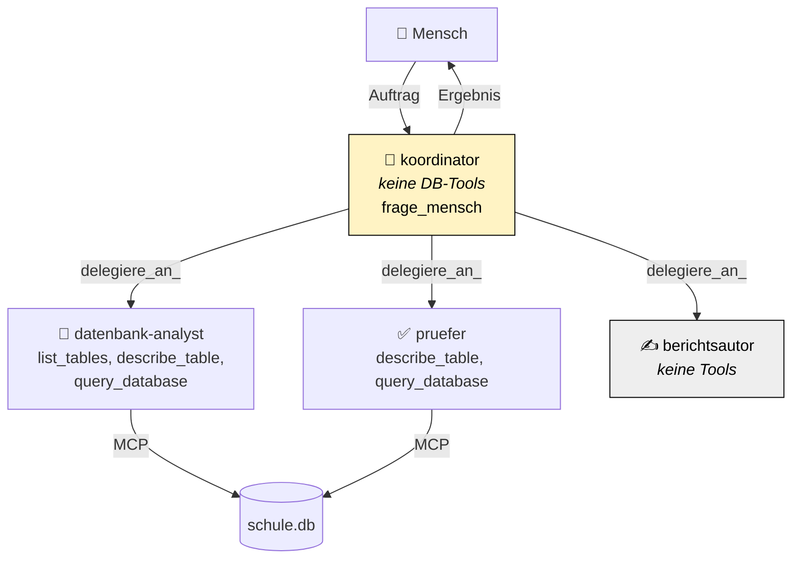

# 4 · Multiagentensysteme

> **Leitfrage:** Wann ist ein Team aus Agenten besser als ein einzelner Agent – und wann nicht?

## Was ist ein Multiagentensystem?

Ein **Multiagentensystem** besteht aus mehreren Agenten, die zusammen eine Aufgabe lösen. Jeder Agent hat

- eine eigene **Rolle** (eigener System-Prompt),
- einen eigenen **Kontext** (eigener Verlauf – er sieht nicht, was die anderen erlebt haben),
- eigene **Rechte** (eigene Tools).

Technisch ist das bei uns überraschend einfach: **Ein Agent wird für einen anderen Agenten zum Tool.** Der Koordinator sieht in seiner Toolliste zum Beispiel:

```
delegiere_an_datenbank-analyst(auftrag)
delegiere_an_pruefer(auftrag)
delegiere_an_berichtsautor(auftrag)
```

Ruft er so ein „Tool“ auf, startet der Harness einen **neuen Agenten mit leerem Verlauf**. Dessen Endergebnis kommt als Tool-Ergebnis zum Koordinator zurück.

## Unser Team



| Agent | Rolle | Darf in die DB? | Warum so? |
|---|---|---|---|
| `koordinator` | zerlegt den Auftrag, verteilt, fasst zusammen | **nein** | Er soll planen, nicht selbst rechnen. |
| `datenbank-analyst` | holt Fakten per SQL | lesen | Spezialist für SQL |
| `pruefer` | prüft Zahlen unabhängig nach | lesen | **Vier-Augen-Prinzip** |
| `berichtsautor` | schreibt Text für Eltern | **nein** | Kann keine Daten „nachschlagen“ und dabei Namen preisgeben |

Starten:

```powershell
python agenten/agent.py --agent koordinator --modell anthropic "Schreibe einen kurzen Text für den Elternabend der 7a über den Notenstand in Mathematik."
```

Im Protokoll siehst du die Unteragenten **eingerückt** (`│`). So erkennst du, welcher Agent gerade arbeitet.

## Typische Muster

| Muster | Ablauf | Beispiel |
|---|---|---|
| **Koordinator–Spezialisten** (*orchestrator–workers*) | Ein Agent plant und verteilt Teilaufgaben, sammelt die Ergebnisse ein. | unser `koordinator` |
| **Pipeline** | Agent A → Agent B → Agent C, fest verdrahtet | Analyst → Prüfer → Autor in fester Reihenfolge (eigentlich ein *Workflow*) |
| **Erzeuger–Prüfer** (*evaluator–optimizer*) | Einer erstellt, ein anderer kritisiert, bis die Qualität stimmt | `datenbank-analyst` + `pruefer` |
| **Parallel** | Mehrere Agenten arbeiten gleichzeitig an Teilen, Ergebnisse werden zusammengeführt | Je ein Analyst pro Klasse |

## Warum mehrere Agenten?

| Vorteil | Erklärung |
|---|---|
| **Spezialisierung** | Kurze, klare System-Prompts statt eines Riesen-Prompts für alles |
| **Saubere Kontexte** | Jeder Unteragent startet frisch und wird nicht von langen Zwischenergebnissen abgelenkt |
| **Minimale Rechte** | Jeder bekommt nur die Tools, die er braucht |
| **Kontrolle** | Ein unabhängiger Prüfer findet Fehler, die der Ersteller übersieht |

## Warum lieber nicht?

| Nachteil | Erklärung |
|---|---|
| **Kosten** | Jeder Agent bekommt bei jedem Schritt seinen ganzen Kontext neu → viel mehr Tokens. Schau dir am Ende die Tabelle *„LLM-Aufrufe und Tokens pro Agent“* an! |
| **Stille Post** | Unteragenten kennen den Verlauf nicht. Vergisst der Koordinator eine Information im Auftrag (z. B. die Klasse), arbeitet der Unteragent mit falschen Annahmen. |
| **Fehlerfortpflanzung** | Ein Fehler des Analysten wandert ungeprüft in den Bericht – wenn niemand prüft. |
| **Schwerer nachzuvollziehen** | Mehr Agenten = längeres Protokoll |

> **Faustregel:** Erst einen einzelnen Agenten bauen. Ein Team nur dann, wenn Aufgaben sich klar trennen lassen **und** der Nutzen die Kosten rechtfertigt.

## Wie wird ein Team *definiert*?

Alles steht in den Definitionsdateien – kein Agent „weiß“ etwas, das dort nicht steht:

```markdown
---
name: koordinator
beschreibung: Zerlegt größere Aufträge in Teilaufgaben und verteilt sie an Spezialisten.
tools:
mensch_fragen: ja
delegiert_an: datenbank-analyst, pruefer, berichtsautor
max_schritte: 12
---
Du bist der Koordinator eines kleinen Agenten-Teams ...
```

Die Zeile `beschreibung` ist wichtig: Sie landet in der Tool-Beschreibung von `delegiere_an_...`. **Daran entscheidet der Koordinator, wen er beauftragt.**

## Kontrollfragen

1. Warum bekommt der Koordinator *keinen* Datenbankzugriff, obwohl das schneller wäre?
2. Der Analyst liefert „Der Schnitt ist 2,9“. Der Koordinator gibt an den Autor nur „Schreib was über den Schnitt“ weiter. Was geht schief?
3. Vergleiche die Token-Zahlen eines Laufs mit `datenbank-analyst` allein und mit `koordinator`. Erkläre den Unterschied.
4. Welches Muster würdest du für „Erstelle für jede der 12 Klassen eine Notenübersicht“ wählen?
