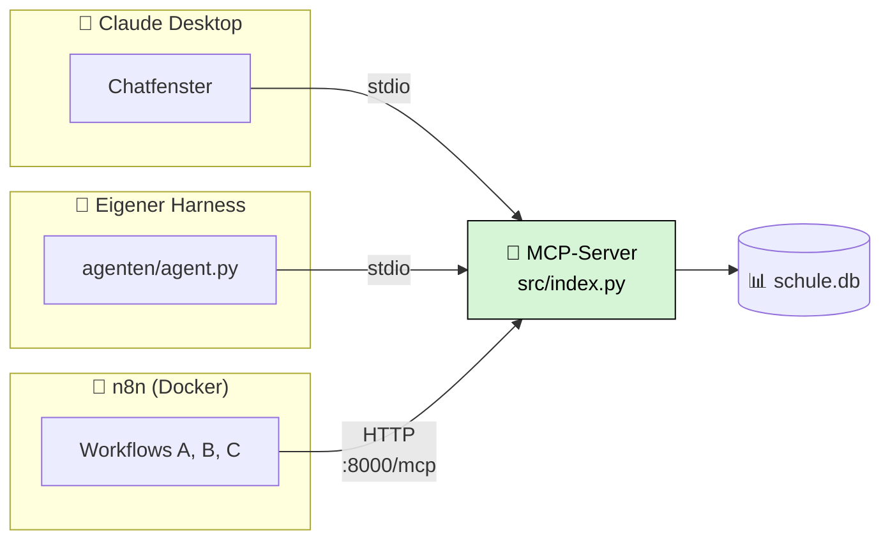
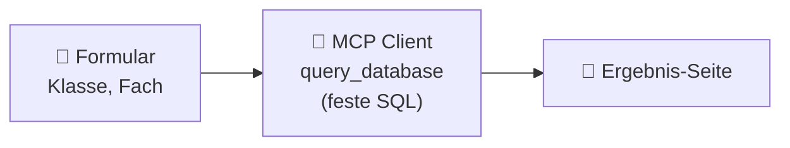
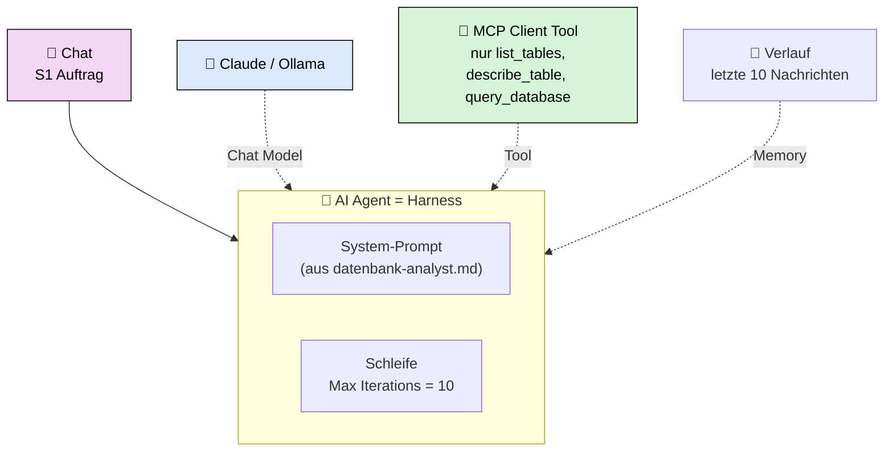
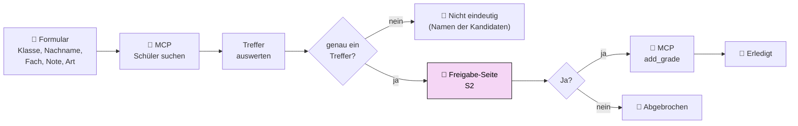

# 6 · Derselbe Agent in n8n

> **Leitfrage:** Was bleibt gleich und was ändert sich, wenn wir den Harness austauschen?

Bisher hast du zwei Harnesses kennengelernt: **Claude Desktop** (Teil 1) und unseren **eigenen Harness** in `agenten/harness/` (Kapitel 2). Jetzt kommt ein dritter dazu: **n8n**.

n8n ist ein Werkzeug, mit dem man Abläufe grafisch zusammenklickt: Knoten auf eine Fläche ziehen, mit Linien verbinden, fertig. Viele Firmen nutzen n8n, um Programme miteinander zu verbinden. Seit einiger Zeit kann n8n auch **KI-Agenten** bauen und **MCP** sprechen.

Für uns ist n8n aus zwei Gründen spannend:

1. **Derselbe MCP-Server, anderer Harness.** n8n spricht mit *genau demselben* `src/index.py` wie Claude Desktop und unser Harness. Am Server ändern wir (fast) nichts.
2. **Workflow und Agent nebeneinander.** In n8n kannst du einen festen Workflow und einen Agenten *auf derselben Fläche* bauen und direkt vergleichen.

> ⚠️ **Reihenfolge beachten:** Bearbeite dieses Kapitel erst **nach** Kapitel 1–5. Der Knoten „AI Agent“ in n8n ist wieder eine **Blackbox**: Die Agenten-Schleife steckt darin, und man sieht sie nicht. Erkennen kannst du sie nur, weil du sie in Kapitel 2 schon selbst gesehen hast.

---

## Das Bild: ein Server, drei Harnesses



**Neu ist nur der Transportweg.** Claude Desktop und unser Harness starten den Server selbst als Unterprozess und reden über **stdio** (Standard-Ein-/Ausgabe) mit ihm. n8n läuft in einem eigenen Container und kann das nicht. Es spricht MCP **nur über HTTP**. Deshalb kennt `src/index.py` jetzt einen zweiten Modus:

```powershell
python src/index.py          # stdio (Standard) – für Claude Desktop und unseren Harness
python src/index.py --http   # HTTP – Endpunkt http://<rechner>:8000/mcp
```

Die Tools, ihre Beschreibungen und die Datenbank bleiben gleich. **Das Protokoll MCP ist der Vertrag**, der Harness ist austauschbar.

---

## Einrichten

### Voraussetzungen

- **Docker Desktop** für Windows. Docker braucht **WSL2** und bei der Installation **Administratorrechte**.
- Auf Schulrechnern ist das oft nicht möglich. Dann richtet die Lehrkraft **einen zentralen n8n-Container** auf einem Lehrer- oder Schulserver ein, und alle arbeiten im Browser darauf (siehe *Hinweise für Lehrkräfte* unten).

### Starten

Im Ordner `n8n/` liegt eine `docker-compose.yml`. Sie startet zwei Container:

| Container | Was er tut | Adresse |
|---|---|---|
| `mcp-server` | unser `src/index.py --http` (erzeugt `schule.db`, falls sie fehlt) | intern `http://mcp-server:8000/mcp`, vom eigenen Rechner `http://localhost:8000/mcp` |
| `n8n` | der Harness mit der grafischen Oberfläche | `http://localhost:5678` |

```powershell
cd n8n
docker compose up -d

# Die drei Workflows einmalig importieren
docker compose exec n8n n8n import:workflow --separate --input=/workflows
```

Warte nach dem Start etwa **30 Sekunden**, denn der MCP-Server installiert beim ersten Start noch `fastmcp`. Öffne dann **http://localhost:5678**. Beim ersten Mal legst du ein Benutzerkonto an. Es bleibt lokal auf deinem Rechner.

> 💡 **Port 5678 schon belegt?** Dann einen anderen wählen:
> `$env:N8N_PORT = "5679"; docker compose up -d` → Adresse `http://localhost:5679`

### Zugangsdaten für das LLM (nur Workflow B)

Die Workflows enthalten **keine** Schlüssel. In n8n heißen Zugangsdaten **Credentials** und werden getrennt gespeichert:

| LLM | Credential in n8n | Einstellung |
|---|---|---|
| Claude | *Anthropic* | API-Key von console.anthropic.com |
| Ollama auf deinem Rechner | *Ollama* | Base URL: `http://host.docker.internal:11434` |

`localhost` würde hier **nicht** funktionieren: Aus Sicht des Containers ist `localhost` der Container selbst. `host.docker.internal` ist der Windows-Rechner dahinter.

---

## Workflow A · fester Ablauf, ohne KI

Öffne **„A – Fester Workflow: Notenstand“**.



Der Ablauf ist **immer derselbe**: Formular ausfüllen, eine fest programmierte SQL-Abfrage wird über MCP an unseren Server geschickt, das Ergebnis erscheint. **Kein LLM** ist beteiligt. Der Knoten heißt hier *MCP Client* (ohne „Tool“). Er ruft ein bestimmtes Tool direkt auf, so wie ein normales Programm eine Funktion aufruft.

**Ausprobieren:** Klicke unten auf **Execute workflow**, fülle das Formular aus und sieh dir danach jeden Knoten an (Doppelklick → rechts *Output*).

### Was kommt vom MCP-Server zurück?

Klicke auf den Knoten *MCP: query_database* und schau dir die Ausgabe an:

```json
{
  "structuredContent": { "result": "[\n  {\n    \"durchschnitt\": 2.99, ... }\n]" },
  "content": [
    { "type": "text", "text": [ { "durchschnitt": 2.99, "anzahl": 85, ... } ] }
  ]
}
```

Unser Server liefert **Text** zurück (siehe `return json.dumps(...)` in `src/index.py`). n8n erkennt, dass dieser Text JSON ist, und wandelt ihn **automatisch in eine Liste** um. Deshalb kann der nächste Knoten einfach `$json.content[0].text[0].durchschnitt` lesen.

Liefert der Server dagegen normalen Text wie `Fehler: Nur SELECT-Abfragen sind erlaubt!` oder `OK: Note 2.3 ... eingetragen`, steht in `content[0].text` ein **String**. Die Workflows A und C prüfen das mit `typeof antwort === 'string'`.

---

## Workflow B · ein Agent

Öffne **„B – Agent: Datenbank-Analyst“**. Auf der Fläche markieren farbige Notizzettel die Teile, die du aus Kapitel 1 kennst:



| Teil aus Kapitel 1 | Wo in n8n? | Wo in unserem Harness? |
|---|---|---|
| **Harness / Schleife** | Knoten *AI Agent* | `harness/harness.py` |
| **System-Prompt** | *AI Agent → Options → System Message* | `definitionen/datenbank-analyst.md` |
| **Schrittlimit (S4)** | *AI Agent → Options → Max Iterations* | `max_schritte` |
| **LLM** | Knoten *Claude* oder *Ollama* (unten links) | `harness/llm.py` |
| **Tools** | Knoten *MCP Client Tool* | `harness/mcp_bruecke.py` |
| **Erlaubte Tools (S0)** | *Tools to Include → Selected* | `tools:` in der Definitionsdatei |
| **Verlauf** | Knoten *Verlauf* (Simple Memory) | Liste `nachrichten` im Harness |
| **Auftrag (S1)** | Knoten *Chat* → Button **Open chat** | `mensch.auftrag_holen()` |
| **Protokoll (S5)** | Reiter **Executions** oben, *Logs* unter dem Chat | `agenten/protokolle/*.jsonl` |

**Ausprobieren:** Credential beim Knoten *Claude* auswählen, dann unten **Open chat** und z. B. fragen:
*„Welche Klasse hat den besten Durchschnitt in Mathematik?“*

Öffne danach die **Logs**. Dort siehst du, wie oft der Agent das LLM aufgerufen hat und welche Tools es dabei benutzt hat. Das ist dieselbe Schleife wie in Kapitel 2, nur in einer anderen Darstellung.

> 🔁 **LLM tauschen:** Ziehe die Verbindung vom Knoten *Claude* zum Eingang *Chat Model* des Agenten auf den Knoten *Ollama* um. Sonst ändert sich nichts. Das LLM ist ein austauschbares Bauteil.

### Workflow oder Agent? A und B im Vergleich

| | **A – Workflow** | **B – Agent** |
|---|---|---|
| Wer entscheidet die Schritte? | der Mensch, der den Workflow gebaut hat | das LLM, zur Laufzeit |
| Welche Fragen sind möglich? | nur „Durchschnitt von Klasse X in Fach Y“ | jede Frage, die sich mit SELECT beantworten lässt |
| Wie viele MCP-Aufrufe? | immer genau **einer** | unterschiedlich viele, je nach Frage und Modell |
| Kosten | keine | Tokens bei jedem Schritt |
| Gleiche Eingabe → gleiches Ergebnis? | **ja, immer** | meistens, aber nicht garantiert |
| Fehler finden | einfach: jeden Knoten ansehen | schwerer: Warum hat das LLM *diese* Abfrage gewählt? |

---

## Workflow C · Schreiben nur mit Freigabe

Öffne **„C – Workflow mit Freigabe: Note eintragen“**. Dieser Workflow ruft das **schreibende** Tool `add_grade` auf, aber erst, wenn ein Mensch zugestimmt hat.



Erinnerst du dich an die Diskussionsfrage aus Kapitel 3? Die Freigabe-Meldung unseres Harness zeigte nur IDs:

```
⚠ FREIGABE NÖTIG: ... 'add_grade' mit {"schueler_id": 37, "kurs_id": 12, "note": 2.0, ...}
```

Workflow C sucht **vorher** Schüler und Kurs heraus und zeigt auf der Freigabe-Seite:

> **Freigabe nötig**
> Soll die Note 2.3 (Schulaufgabe) für Clara Bauer, Klasse 7a, im Fach Mathematik eingetragen werden?

So kann der Mensch die Freigabe **verantwortungsvoll** erteilen. Gibt es den Nachnamen in der Klasse mehrmals, fragt der Workflow nicht nach, sondern bricht ab und nennt die Kandidaten.

**Merke:** Workflow C enthält **kein LLM**. Eine Freigabe (S2) ist keine Erfindung für KI-Agenten. Sie ist ein allgemeines Prinzip für jede Software, die etwas Wichtiges verändert.

---

## Drei Harnesses im Vergleich

| | **Claude Desktop** | **Eigener Harness** | **n8n** |
|---|---|---|---|
| Verbindung zum MCP-Server | stdio | stdio | HTTP |
| LLM austauschbar? | nein (nur Claude) | ja (Anthropic, Ollama, Mensch) | ja (viele Anbieter) |
| Agenten-Schleife sichtbar? | nein | **ja, im Code** | nur in den Logs |
| Tool-Auswahl (S0) | Schalter pro Tool | `tools:` in der Definition | *Tools to Include* |
| Freigabe (S2) | Dialog „Erlauben?“ | `tools_mit_freigabe` | selbst bauen (Formular wie in C) oder Messenger-Knoten mit „Send and wait“ |
| Feste Workflows möglich? | nein | nein | **ja**, die eigentliche Stärke von n8n |
| Multiagenten | nein | ja (`delegiert_an`) | ja (ein Agent als Tool eines anderen) |
| Wofür gut? | Alltag, Ausprobieren | **Verstehen** | Abläufe automatisieren, Programme verbinden |

---

## Sicherheit: SQL-Injection

In A und C setzt der Workflow Formulareingaben in eine SQL-Abfrage ein. Das ist gefährlich, wenn jemand statt eines Namens SQL-Code eingibt.

- In **A** sind Klasse und Fach **Dropdowns**. Man kann nur vorgegebene Werte auswählen.
- In **C** ist der *Nachname* ein **freies Textfeld**. Deshalb verdoppelt der Workflow jedes Hochkomma: `replace(/'/g, "''")`. Aus `O'Brien` wird `'O''Brien'`. Das ist für SQLite ein ganz normaler Text.
- Als zweite Schutzschicht lässt `query_database` nur Abfragen zu, die mit `SELECT` beginnen.

Noch sicherer wären **Parameter** (`?` in der SQL, so wie `add_grade` es intern macht). Unser Tool `query_database` nimmt aber nur einen fertigen SQL-Text an.

---

## Hinweise für Lehrkräfte

- **Zentraler Server statt Docker auf jedem Rechner:** Den Stack einmal auf einem Lehrer- oder Schulserver starten, und zwar mit dessen Adresse: `$env:N8N_URL = "http://<server>:5678"; docker compose up -d`. Ohne `N8N_URL` baut n8n die Links für Chat und Formulare mit `localhost`. Dann funktioniert auf den Schülerrechnern **Open chat** nicht („Failed to receive response“). `N8N_SECURE_COOKIE=false` erlaubt dafür die Anmeldung über `http://`. Jede Gruppe bekommt einen eigenen n8n-Benutzer (Einladung über *Settings → Users*). Alle teilen sich dann **eine** `schule.db`.
- **Port 8000** ist absichtlich nur vom Server selbst erreichbar (`127.0.0.1:8000`). Der MCP-Server hat **keine Anmeldung**. Offen im Netz könnte jeder `add_grade` aufrufen.
- **Aktivieren heißt jetzt „Publish“:** In n8n 2.x werden Workflows über **Publish** produktiv geschaltet (früher „Active“). Erst danach funktioniert die feste Formular-Adresse (*Production URL*). Zum Ausprobieren im Editor reicht **Execute workflow**. Per Kommandozeile: `docker compose exec n8n n8n publish:workflow --id=<ID>`.
- **Nach einem Update der `requirements.txt`** den MCP-Container neu erzeugen: `docker compose up -d --force-recreate mcp-server`. Ein einfacher Neustart reicht nicht: Der alte Container behält die alten Pakete, und ein abgebrochenes Update kann `fastmcp` beschädigen.
- **Neu importieren** überschreibt die drei Workflows, weil sie feste IDs haben. Eigene Änderungen der Schüler gehen dabei verloren.
- **Datenbank zurücksetzen:** Workflow C verändert `schule.db`. `python create_database.py` im Projektordner erzeugt sie neu. Danach `docker compose restart mcp-server` ist nicht nötig, weil der Server die Datei bei jedem Aufruf neu öffnet.
- **Getestete Version:** n8n **2.48.8** (in der `docker-compose.yml` fest eingestellt). Bei neueren Versionen können sich Knoten-Namen und Menüs leicht ändern.

---

## Aufgaben

1. **Gleiche Frage, zwei Wege:** Ermittle den Mathe-Durchschnitt der 7a einmal mit Workflow A und einmal mit Workflow B. Vergleiche: Ergebnis, Dauer, Anzahl der MCP-Aufrufe (Logs bzw. Executions). Stelle in B danach eine Frage, die A **nicht** beantworten kann.
2. **Harness-Teile finden:** Fülle die Tabelle „Teil aus Kapitel 1 → Wo in n8n?“ ohne Vorlage aus, indem du in Workflow B jeden Knoten öffnest.
3. **S0 in n8n:** Schalte im Knoten *MCP Client Tool* zusätzlich `add_grade` frei. Bitte den Agenten im Chat, eine Note einzutragen. Was passiert? Fragt n8n dich vorher? Vergleiche mit dem `notenverwalter` aus Kapitel 3 und begründe, warum das gefährlich ist. *(Danach `add_grade` wieder entfernen!)*
4. **Freigabe testen:** Trage mit Workflow C eine Note für einen Nachnamen ein, der in der Klasse **mehrmals** vorkommt (Tipp: `SELECT nachname, COUNT(*) FROM schueler WHERE klasse='7a' GROUP BY nachname HAVING COUNT(*) > 1`). Was zeigt der Workflow? Wie würde ein Agent in derselben Lage reagieren?
5. **SQL-Injection:** Gib in Workflow C als Nachnamen `x' OR '1'='1` ein. Erkläre mithilfe der Ausführung (Knoten *MCP: Schüler suchen* → *Input*), warum nicht alle Schüler gefunden werden. Was würde ohne `replace(...)` passieren?
6. **LLM tauschen** 🧠: Stecke Workflow B auf Ollama um und stelle dieselbe Frage wie in Aufgabe 1. Unterscheiden sich die SQL-Abfragen? Ist das Ergebnis trotzdem richtig?

---

## Ausblick: n8n als MCP-Server

n8n kann auch die **andere Seite** spielen: Mit dem Knoten **MCP Server Trigger** wird ein n8n-Workflow selbst zu einem MCP-Server. So könnte man etwa einen Workflow „Rückmeldung per E-Mail an die Klasse verschicken“ bauen und ihn unserem **eigenen Harness** als Tool anbieten.

Dafür müsste `agenten/harness/mcp_bruecke.py` statt eines Skriptpfads auch eine **URL** annehmen und per HTTP verbinden. Eine gute Aufgabe für Fortgeschrittene, und eine gute Gelegenheit, über **S2** zu sprechen: Eine verschickte E-Mail kann man nicht mehr zurückholen.

---

## Kontrollfragen

1. Warum musste `src/index.py` einen HTTP-Modus bekommen? Was hat sich am Server **nicht** geändert?
2. Workflow A und Workflow B benutzen beide MCP. Warum ist nur B ein Agent?
3. Nenne für Workflow B die Knoten, die zusammen dem *Harness* aus Kapitel 1 entsprechen.
4. Workflow C enthält kein LLM, aber eine Freigabe. Welche Schnittstelle (S0–S5) ist das, und warum braucht auch ein fester Workflow sie?
5. Warum steht in der Ollama-Credential `host.docker.internal` und nicht `localhost`?
6. Wann würdest du in der Schule n8n einsetzen, wann den eigenen Harness, wann Claude Desktop?
