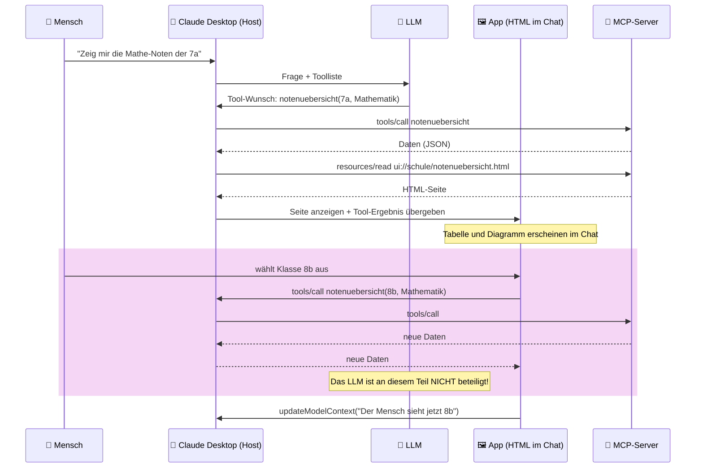

# Teil 1b · MCP Apps: Tools mit eigener Oberfläche

> **Leitfrage:** Wie kann ein MCP-Server nicht nur Text, sondern eine richtige Oberfläche in den Chat bringen, und was ändert sich dadurch für den Menschen?

In Teil 1 hat der MCP-Server immer **Text** zurückgegeben, meistens JSON. Claude hat daraus eine Antwort formuliert. Das funktioniert, hat aber Grenzen:

- Eine Notenübersicht mit 17 Schülern ist als Text unübersichtlich.
- Will man eine andere Klasse sehen, muss man wieder fragen, und das LLM muss wieder ein Tool aufrufen.
- Beim schreibenden Tool `add_grade` fragt Claude Desktop zwar um Erlaubnis, zeigt dabei aber nur `schueler_id: 37, kurs_id: 12`. Wer ist das?

**MCP Apps** lösen das. Seit Januar 2026 ist das die erste offizielle Erweiterung von MCP, gemeinsam entwickelt von Anthropic und OpenAI. Ein MCP-Server kann damit zu einem Tool eine **HTML-Seite** mitliefern. Der Host (z. B. Claude Desktop) zeigt sie **direkt im Chat** an.

---

## Die zwei Teile einer MCP-App

| Teil | Was ist das? | In unserem Projekt |
|---|---|---|
| **UI-Ressource** | eine HTML-Seite, die der Server unter einer Adresse mit `ui://` anbietet | `ui://schule/notenuebersicht.html` → Datei `src/apps/notenuebersicht.html` |
| **Tool mit Verweis** | ein normales Tool, das im Feld `_meta.ui.resourceUri` auf die Ressource zeigt | `notenuebersicht(klasse, fach)` |

In `src/index.py` sieht das so aus:

```python
# 1. Die HTML-Seite als Ressource
@mcp.resource("ui://schule/notenuebersicht.html", mime_type=UI_MIME_TYPE, app=APP_SICHERHEIT)
def notenuebersicht_seite() -> str:
    return (APPS_ORDNER / "notenuebersicht.html").read_text(encoding="utf-8")

# 2. Das Tool zeigt auf diese Seite
@mcp.tool(app=AppConfig(resource_uri="ui://schule/notenuebersicht.html"))
def notenuebersicht(klasse: str, fach: str) -> dict:
    ...
```

Der Rest ist ganz normales MCP: Das Tool gibt Daten zurück, und das LLM sieht diese Daten wie immer.

---

## Was passiert, wenn das LLM das Tool aufruft?



Zwei Dinge sind neu:

1. **Der Host holt eine Ressource und zeigt sie an.** Die HTML-Seite läuft in einem abgeschotteten Rahmen (*sandboxed iframe*). Sie kann nicht auf den Rest von Claude Desktop zugreifen.
2. **Die App kann selbst Tools aufrufen.** Der rosa Bereich im Diagramm läuft komplett **ohne LLM**: Der Mensch klickt, die App fragt über den Host den Server, die Anzeige ändert sich. Das ist schneller, kostet keine Tokens und ist vorhersagbar, wie ein Workflow.

Damit das LLM trotzdem weiß, was der Mensch gerade sieht, kann die App ihm mit `updateModelContext` still eine Notiz schicken. Fragst du danach im Chat „Wer ist hier am besten?“, weiß Claude, dass die 8b gemeint ist.

### Ist eine MCP-App ein Tunnel zum Server?

Man könnte meinen, die App sei ein Tunnel, der den Menschen direkt mit dem MCP-Server verbindet. Das stimmt nur zur Hälfte:

| Stimmt | Stimmt nicht |
|---|---|
| Klickt der Mensch in der App, wird das **LLM nicht gefragt**. Es kann dabei nichts verändern oder erfinden. | Die App hat **keine eigene Verbindung** zum Server. Jeder Aufruf geht als Nachricht an den **Host**, und der leitet ihn weiter. |
| Bei der Freigabe ist das gewollt: Die Entscheidung läuft am LLM vorbei. | Der Host ist der **Harness**. Er zeigt die App abgeschottet an, prüft die CSP und entscheidet, welche Tools die App aufrufen darf. |
| | Das **LLM öffnet** die App mit seinem Tool-Aufruf und sieht das erste Ergebnis. |
| | Das LLM bleibt **informiert** (`updateModelContext`). Ein Tunnel wäre unsichtbar. |

**Ein besseres Bild ist ein Bankschalter:** Der Berater (das LLM) schickt dich an den Schalter (die App). Dort erledigst du dein Geschäft direkt mit der Bank (dem MCP-Server), ohne dass der Berater dabei ist. Der Schalter gehört aber zur Filiale (dem Host): Sie bestimmt, was am Schalter möglich ist, und hat alles im Blick. Hinterher bekommt der Berater eine Notiz, was du erledigt hast.

> **Merke:** Eine MCP-App ist ein Weg **am LLM vorbei**, aber **nie am Harness vorbei**.

---

## Die HTML-Seite: so spricht sie mit dem Host

Die Seiten in `src/apps/` sind normales HTML mit etwas JavaScript. Für die Verbindung zum Host gibt es eine fertige Bibliothek mit der Klasse `App`:

```javascript
import { App } from "https://cdn.jsdelivr.net/npm/@modelcontextprotocol/ext-apps@2.0.4/dist/src/app-with-deps.js";

const app = new App({ name: "Notenübersicht", version: "1.0.0" }, {});

// 1) Das LLM hat das Tool aufgerufen → der Host schickt uns das Ergebnis
app.ontoolresult = (ergebnis) => anzeigen(datenAus(ergebnis));

// 2) Der Mensch klickt → die App ruft selbst ein Tool auf
const ergebnis = await app.callServerTool({ name: "notenuebersicht", arguments: { klasse, fach } });

// 3) Dem LLM mitteilen, was der Mensch jetzt sieht
await app.updateModelContext({ content: [{ type: "text", text: "Der Mensch sieht jetzt ..." }] });

await app.connect();   // Verbindung zum Host aufbauen
```

Hinter diesen Methoden steckt wieder **JSON-RPC**, dasselbe Nachrichtenformat wie bei MCP selbst. Die App und der Host schicken sich Nachrichten wie `ui/initialize`, `ui/notifications/tool-result` oder `tools/call` per `postMessage` hin und her.

---

## Die Freigabe-App: der Mensch entscheidet im Chat

Die zweite App zeigt, wie eine **gute Freigabe** aussehen kann. Bittest du Claude, eine Note einzutragen, ruft es **nicht** `add_grade` auf, sondern `note_vorschlagen`. Dieses Tool schreibt nichts. Es sucht nur Schüler und Kurs heraus. Im Chat erscheint:

> **👤 Freigabe nötig**
> Soll die Note 2.3 (Schulaufgabe) im Fach Mathematik, Klasse 7a für Clara Bauer eingetragen werden?
> [ Ja, eintragen ]  [ Nein, abbrechen ]

Gibt es den Nachnamen mehrmals, wählt **der Mensch** die richtige Person aus einer Liste aus, nicht das LLM. Erst der Klick auf „Ja, eintragen“ ruft das Tool `note_freigeben` auf, und das schreibt in die Datenbank.

| | Freigabe von Claude Desktop (Teil 1) | Freigabe-App (Teil 1b) |
|---|---|---|
| Was sieht der Mensch? | Toolname und Rohdaten: `{"schueler_id": 76, "kurs_id": 23, ...}` | „Clara Bauer, 7a, Mathematik, 2.3 (Schulaufgabe)“ |
| Mehrere Treffer? | Das LLM rät, wer gemeint ist. | Der Mensch wählt aus. |
| Wer drückt den Knopf? | der Mensch | der Mensch, aber er weiß, *was* er freigibt |

### `visibility`: nur für die App, nicht für das LLM

```python
@mcp.tool(app=AppConfig(resource_uri="ui://schule/notenfreigabe.html", visibility=["app"]))
def note_freigeben(schueler_id: int, kurs_id: int, note: float, art: str) -> str:
```

`visibility=["app"]` heißt: Dieses Tool ist für die Oberfläche gedacht. Der Host zeigt es dem LLM nicht an. Das LLM kann `note_freigeben` also nicht selbst aufrufen und die Freigabe umgehen.

> ⚠️ **Aber Achtung:** `visibility` ist eine **Absprache**, keine Sicherheitsgrenze. Der Server schickt das Tool trotzdem bei `tools/list` mit. Er verlässt sich darauf, dass der Host es vor dem LLM versteckt. Ein Client, der sich nicht daran hält, kann es aufrufen. Probiere es in Aufgabe 6 aus.

---

## Sicherheit

| Schutz | Wo? | Wovor schützt er? |
|---|---|---|
| **Sandbox** | Host | Die App läuft abgeschottet und kann nicht auf andere Chats oder Dateien zugreifen. |
| **CSP** (Content Security Policy) | `APP_SICHERHEIT` in `src/index.py` | Die App darf nur Skripte von erlaubten Adressen laden. Wir erlauben genau eine: `https://cdn.jsdelivr.net`. |
| **`textContent` statt `innerHTML`** | HTML-Dateien | Namen aus der Datenbank werden nie als HTML-Code ausgeführt. |
| **Prüfung im Server** | `note_in_datenbank_schreiben()` | Ungültige Noten werden abgelehnt, egal ob der Aufruf vom LLM, von der App oder von woanders kommt. |

Die letzte Zeile ist die wichtigste: **Entscheidend ist, was der Server prüft.** Alles andere kann umgangen werden.

---

## Einrichten

Die MCP Apps brauchen eine neuere FastMCP-Version (3.4.11). Wer Teil 1 schon eingerichtet hat, aktualisiert sie:

```powershell
.\venv\Scripts\Activate.ps1
pip install -r requirements.txt
```

Danach Claude Desktop **ganz** beenden (Rechtsklick auf das Symbol im Infobereich → *Beenden*, oder über den Task-Manager) und neu starten. An der Konfiguration ändert sich nichts.

**Ausprobieren:**

- *„Zeig mir die Notenübersicht der 7a in Mathematik.“*
- *„Trage für Bauer aus der 7a eine 2,3 in Mathematik als Schulaufgabe ein.“*
- *„Trage für Werner aus der 7a eine 2 in Mathe ein.“* (mehrere Treffer)

> 💡 **Keine Oberfläche zu sehen?** Dann unterstützt der Host keine MCP Apps oder die App konnte nicht geladen werden (z. B. kein Internet für die Bibliothek). Das LLM bekommt trotzdem die Daten als Text und antwortet normal. Eine MCP-App muss immer auch **ohne** Oberfläche sinnvoll funktionieren. Deshalb funktionieren unsere neuen Tools auch in n8n und in unserem eigenen Harness aus Teil 2, nur eben ohne Bild.

---

## Aufgaben

1. **Erste App:** Lass dir die Notenübersicht einer Klasse zeigen. Welches Tool ruft Claude auf? Was sieht das LLM, was siehst du? (Tipp: Klappe den Tool-Aufruf im Chat auf.)
2. **Ohne LLM:** Wechsle in der Oberfläche Klasse und Fach. Wird dabei das LLM gefragt? Woran erkennst du das? Was bedeutet das für Kosten und Geschwindigkeit?
3. **Das LLM weiß Bescheid:** Wechsle in der App auf eine andere Klasse und frage dann im Chat: *„Wer hat hier den besten Durchschnitt?“* Bezieht sich Claude auf die Klasse, die du gerade siehst? Welche Zeile in `notenuebersicht.html` sorgt dafür?
4. **Freigabe:** Lass eine Note für jemanden mit einem Nachnamen eintragen, den es mehrmals gibt. Vergleiche mit der Freigabe von `add_grade` in Teil 1: Welche Freigabe kannst du verantwortungsvoller erteilen? Begründe.
5. **Oberfläche ändern:** Ändere in `src/apps/notenuebersicht.html` die Grenzen für die Farben (Funktion `farbeFuer`), z. B. ab 4.0 rot. Claude Desktop neu starten und testen.
6. **`visibility` ist keine Sicherheit:** Starte `python agenten/minimal_agent.py mensch "Test"` (aus Teil 2). Taucht `note_freigeben` in der Toolliste auf? Was könnte ein LLM hier tun, was in Claude Desktop nicht geht? Wer muss also wirklich für Sicherheit sorgen?
7. **CSP ausprobieren:** Lösche in `src/index.py` bei `APP_SICHERHEIT` die erlaubte Adresse (`resource_domains=[]`) und starte Claude Desktop neu. Was passiert mit der Oberfläche? Was bekommt das LLM trotzdem?
8. **Für Fortgeschrittene:** Baue eine dritte App `lehreruebersicht`: eine Tabelle aller Lehrkräfte mit ihren Fächern, filterbar nach Fach.

---

## Ausblick: Wer baut die Oberfläche?

Bei MCP Apps hat ein **Programmierer** die Oberfläche vorher gebaut. Das LLM entscheidet nur, *wann* sie erscheint. Es gibt auch den umgekehrten Ansatz: Bei **A2UI** (von Google) beschreibt das **LLM selbst zur Laufzeit**, welche Oberfläche erscheinen soll. Mehr dazu in Teil 2, [Kapitel 3](agenten/03_mensch_maschine.md), sobald du weißt, was ein Agent ist.

---

## Kontrollfragen

1. Aus welchen zwei Teilen besteht eine MCP-App? Wo stehen sie in unserem Projekt?
2. Wer zeigt die HTML-Seite an: das LLM, der Host oder der MCP-Server?
3. Die App ruft `callServerTool` auf. Ist das LLM daran beteiligt? Begründe mit dem Sequenzdiagramm.
4. „Eine MCP-App ist ein Tunnel zwischen Mensch und Server.“ Was ist an diesem Satz richtig, was falsch?
5. Warum ist `note_vorschlagen` ungefährlich, `note_freigeben` aber nicht?
6. Erkläre, warum `visibility=["app"]` keine Sicherheitsgrenze ist.
7. Was passiert, wenn ein Host keine MCP Apps unterstützt?
